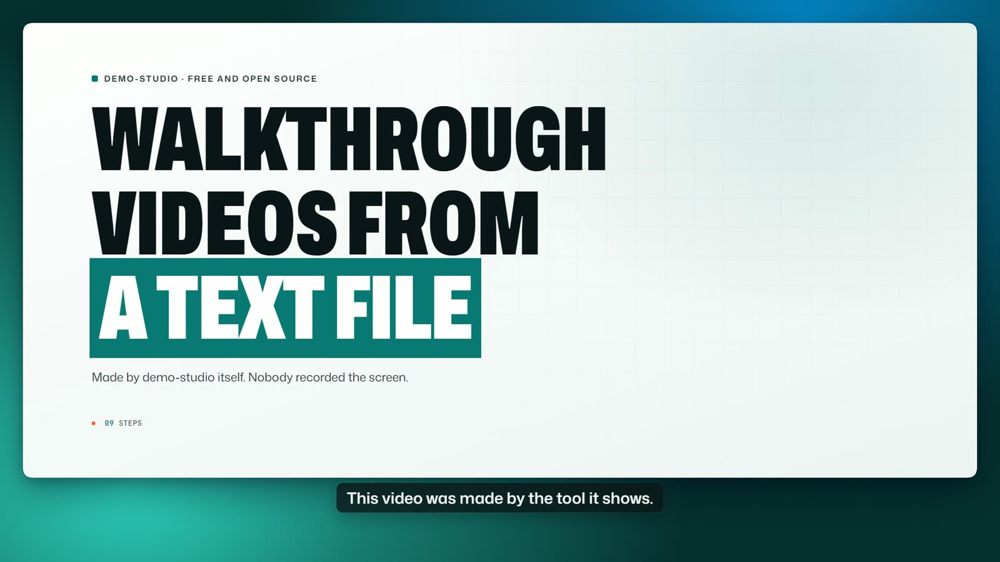
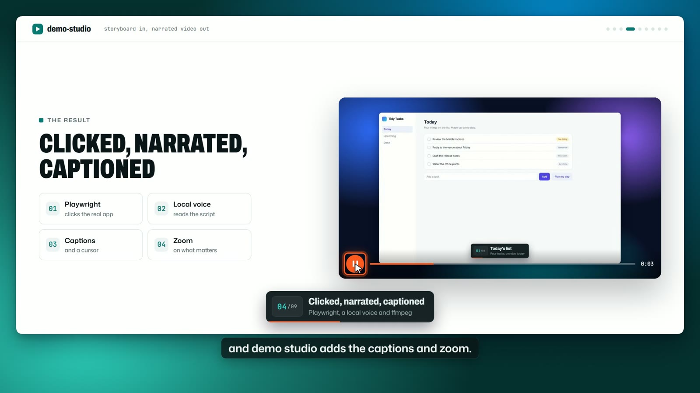
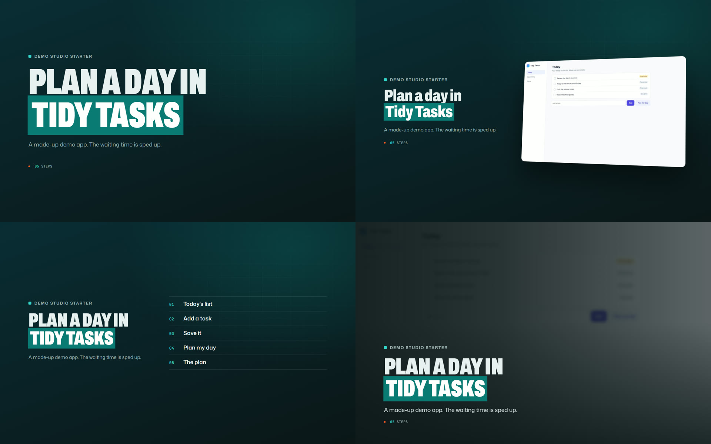
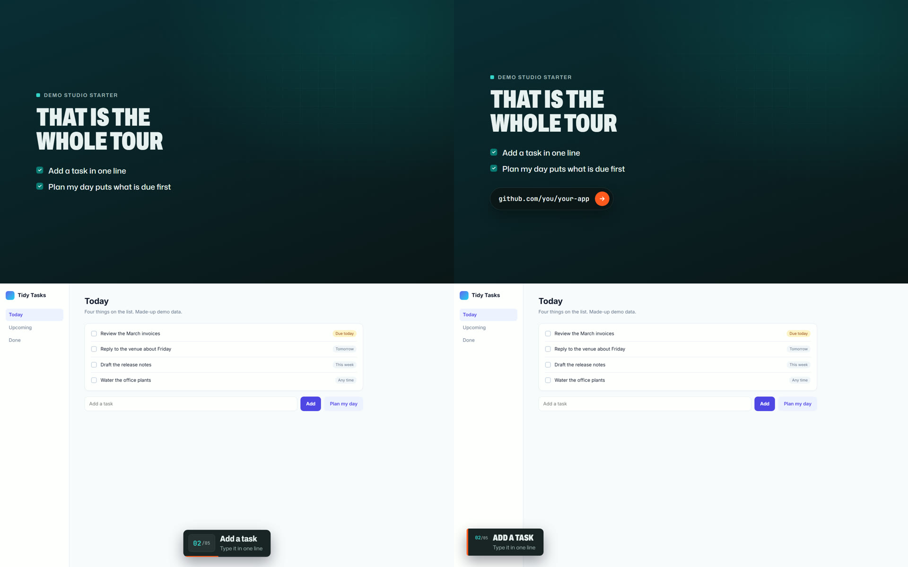
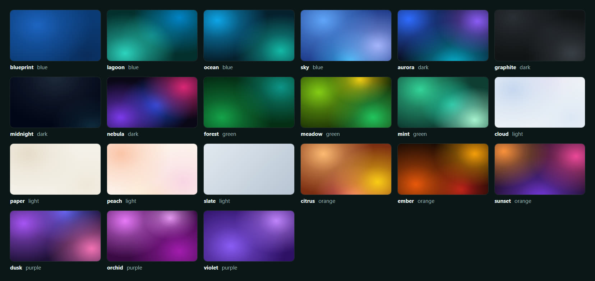

# demo-studio

Storyboard in, narrated product-walkthrough video out.

Ask your coding agent for a walkthrough video of your web app, and get the video file back. The agent writes the script, Playwright drives the real app, a local Kokoro voice reads it, and demo-studio adds captions, a cursor, zoom, subtitles and a framed look, then checks every frame. You do not record your screen, and there is no API key and no subscription.



The showcase video was made by demo-studio itself: [`examples/showcase/`](examples/showcase/).

## Quick start with your coding agent

Paste this into Claude Code, Codex or any coding agent. It installs everything that is missing:

```text
Set up demo-studio on this machine: https://github.com/Maazsiddiqui01/demo-studio-oss
Read https://raw.githubusercontent.com/Maazsiddiqui01/demo-studio-oss/main/AGENTS.md and follow
its Setup section. Install anything that is missing, run `studio doctor --download`, and tell me
when it is ready.
```

Then describe the video you want, in as much detail as you like:

```text
Use demo-studio to make a 60 second walkthrough of my app at http://localhost:3000.
Show signing up, creating the first project and the dashboard. Made-up data only.
Add subtitles and a square version for LinkedIn. Give me the video file.
```

The agent looks at your app, writes the script, renders, reviews every frame and hands you `video.mp4`. More prompts to copy (client handovers, onboarding, release notes, proposal clips) are in [docs/prompts.md](docs/prompts.md). The guide the agent follows is [AGENTS.md](AGENTS.md).

## Quick start by hand

```bash
uv tool install git+https://github.com/Maazsiddiqui01/demo-studio-oss
# or: pipx install git+https://github.com/Maazsiddiqui01/demo-studio-oss
studio init
studio render walkthrough.yaml
```

The first render downloads Chromium (headless shell) and the Kokoro voice model (about 350 MB, checked by SHA-256) into a cache, and `studio doctor` shows what is installed. You need Python 3.10 or newer. CI runs the tests on Ubuntu with Python 3.10 and 3.12, plus a smoke render of `examples/hello`.

## What you get

`studio init` writes a starter storyboard and a small demo app. Rendering the starter produces this folder:

```text
out/tidy-tasks-tour/
  video.mp4        H.264 video with AAC audio
  captions.vtt     captions made from the narration
  poster.jpg       the poster frame
  REPORT.md        durations, what was masked, sources and the gate result
  narration.wav    the voice alone
  qa/sheets/       contact sheets for the frame review
  qa/frames/       one frame every 5 seconds
  qa/gate.json     the gate result as data
```

The other files in the folder are listed in [docs/how-it-works.md](docs/how-it-works.md).



## A storyboard

A storyboard is one YAML file. Each step says what to do on the page, what the caption says and what the voice says. These are steps 2 to 4 of the starter:

```yaml
steps:
  - id: type
    action: type
    target: "[data-demo=new-task]"
    text: "Book the team retro"
    zoom: auto                      # zoom in on the field before the cursor moves there
    caption: { n: 2, title: "Add a task", sub: "Type it in one line" }
    narration: "To add a task, type it in one line."
  - id: add
    action: click
    target: "[data-demo=add]"
    caption: { n: 3, title: "Save it", sub: "It joins the list" }
    narration: "Add puts it at the end of the list."
  - id: plan
    action: click
    target: "[data-demo=plan]"
    wait_for: "[data-demo=plan-result]"
    speed_up: true                  # the wait plays four times faster, and the caption says so
    caption: { n: 4, title: "Plan my day", sub: "The list is sorted for you" }
    narration: "Plan my day sorts the list. The wait is sped up, and the video says so."
```

A cursor moves to each target and a ring marks it. A step that waits for a slow job can play that wait faster and say so on screen. Run `studio validate walkthrough.yaml` to check a storyboard without rendering. The full reference is [docs/storyboard-format.md](docs/storyboard-format.md).

## The look

Pick a theme (`petrol`, `kinetic` or `navy`), an intro layout, an outro layout and a caption style. The recording sits in a rounded window on one of 21 generated wallpapers, and the wallpaper drifts slowly behind the window. You can burn the narration in as subtitles for feeds that autoplay muted, and render a square variant of the same storyboard for social feeds.

```yaml
style:
  background: lagoon     # a preset, a category such as blue, a list of presets, or auto
  theme: kinetic         # petrol | kinetic | navy
  captions: card         # card | pill | lower
  subtitles: true        # burn the narration into the picture
  music: ambient         # a quiet pad made on your machine
variants:
  square:                # studio render walkthrough.yaml --variant square
    viewport: [960, 854]
    style: { canvas: [1080, 1080], padding: 0.05, background: ocean }
```



The intro layouts: `statement`, `product`, `agenda` and `cinematic`. Set one with `intro.layout`, or leave it on `auto`.



The outro layouts `summary` and `cta` on top, and the caption styles `card` and `lower` below. A third outro layout is `cinematic`, and a third caption style is `pill`.



The 21 wallpaper presets, in six categories: dark, blue, purple, orange, green and light.

`studio slides walkthrough.yaml` writes a still of every intro, outro and caption design over your own app, so you can pick before you render. `studio backgrounds` writes the wallpaper gallery above.

## Two modes

Every storyboard declares one mode. The tool refuses to render without it.

| | `public` | `handover` |
|---|---|---|
| For | Anyone: website, portfolio, proposals, social posts | One client, about their own system |
| Data on screen | Made-up or seeded data only. Banned terms, email addresses, phone numbers and web addresses are rejected | The client's real data |
| Sign-in | None, unless the app holds made-up test data | A session you save yourself with `studio login` |
| Output | `out/<name>/`, framed by default, can be published | `out/clients/<client>/<name>/`, stays on your machine, optional private link with an expiry |

A `handover` video can set `local_copy: true` to record a private copy of the app on `localhost` with made-up data. No live system is touched, so form steps are allowed.

In handover mode against a live system, a step that may write data is refused unless it carries `live_write: true` and `confirmed_by_owner: true`. You always sign in yourself: `studio login <name>` opens a visible browser, and demo-studio never types or reads a password. The session is saved outside your project. Passwords, API keys, tokens, card numbers and similar patterns are masked in the page before any frame is captured, in both modes. Details are in [docs/modes-and-privacy.md](docs/modes-and-privacy.md).

## The quality gate

A render is finished when six items pass. See [docs/quality-gate.md](docs/quality-gate.md).

- **Frames.** The gate extracts a frame every 5 seconds and builds contact sheets. You look at them and record the verdict with `studio check --frames pass`.
- **Text scan.** No em or en dashes in any on-screen or spoken text. In public mode, no banned term, email address, phone number or web address on any screen that was recorded.
- **Audio.** Each narration line sits inside its own step, the mix peak stays below -1 dB, and no gap over 3 seconds is left outside the slides. With the `check` extra, a speech check compares the audio with your script.
- **File.** H.264 and AAC, faststart, the right picture size and duration, a poster, and a captions file that parses.
- **Delivery.** `studio publish` ran and its checks passed, or you marked the video `local_only`.
- **Server.** A check that your own server is unchanged apart from demo-studio's parts. It is off unless `publish.host_check` is on, and it reads a result file you write.

Items that wait on a person or a step show as PENDING and count as not passed.

## Publishing

`studio publish out/<name>` writes the video, captions, poster and an embed page to a local folder that any static host can serve, or to your own server over ssh. Handover videos stay local unless the storyboard asks for a private link with an expiry date, which needs Caddy on your server. See [docs/publishing.md](docs/publishing.md).

## Use it from Claude Code

```text
/plugin marketplace add Maazsiddiqui01/demo-studio-oss
/plugin install demo-studio@demo-studio-oss
```

The plugin adds the `make-walkthrough` skill. It guides Claude through installing the CLI, picking a mode, writing the storyboard, rendering and the quality gate.

## Options

Extras, installed with the tool (for example `uv tool install "demo-studio[check] @ git+https://github.com/Maazsiddiqui01/demo-studio-oss"`, or the same requirement with `pip install`):

| Extra | What it adds |
|---|---|
| `[gpu]` | Kokoro on torch, which uses a CUDA GPU when there is one. Install torch for your CUDA first. |
| `[check]` | faster-whisper, for the speech check in the quality gate. |
| `[server]` | bcrypt, for private links on your own server. |

Environment variables:

| Variable | Default | Meaning |
|---|---|---|
| `DEMO_STUDIO_HOME` | the current folder | The workspace: `demo-studio.yaml`, `out/`, and where `studio login` looks for storyboards. |
| `DEMO_STUDIO_OUT` | `<workspace>/out` | Where renders are written. |
| `DEMO_STUDIO_CACHE` | platform cache folder | Voice models, the narration cache and frame assets. Safe to delete. |
| `DEMO_STUDIO_TTS` | auto | `kokoro` (torch) or `kokoro-onnx` (CPU). Auto uses torch when the `kokoro` package is installed. |
| `DEMO_STUDIO_KOKORO_ONNX_DIR` | `<cache>/models` | Folder for the voice model files. |
| `DEMO_STUDIO_FFMPEG` | `ffmpeg` on your PATH | Path to an ffmpeg program. Without one, the copy that comes with the `imageio-ffmpeg` package is used. |

How the stages work, and the known limits, are in [docs/how-it-works.md](docs/how-it-works.md).

## Licences

- demo-studio: MIT, see [LICENSE](LICENSE).
- Voice: Kokoro-82M is Apache-2.0. The model is downloaded at first use from the kokoro-onnx release and is not shipped in this repository. kokoro-onnx, the runtime, is MIT. Do not use a non-commercial voice model with demo-studio.
- Playwright: Apache-2.0. Chromium is downloaded by Playwright.
- Fonts: Inter, Archivo, Mona Sans and JetBrains Mono, under SIL OFL 1.1. They are bundled in `demo_studio/templates/fonts` with their licence files.
- ffmpeg: from your PATH, or from the `imageio-ffmpeg` wheel. It is LGPL or GPL, depending on the build, and demo-studio runs it as a separate program.
- kokoro-onnx installs phonemizer and, through espeakng-loader, eSpeak NG. Both are GPL-3.0 licensed and neither is part of this repository.

Sources and notices for each component are in [THIRD_PARTY_NOTICES.md](THIRD_PARTY_NOTICES.md).

## Contributing

Open an issue first for large changes, and read [CONTRIBUTING.md](CONTRIBUTING.md).
