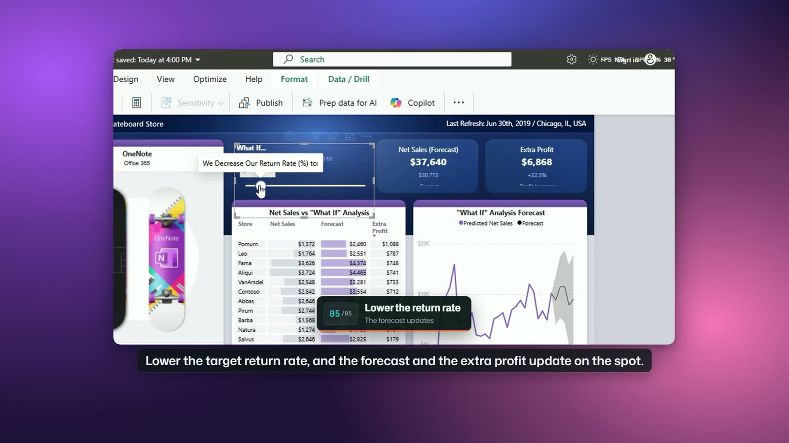

# Desktop apps (Windows)

demo-studio can record a Windows app window as well as a web page: Power BI Desktop, Excel, an
internal tool, anything with a window. The storyboard, captions, zoom, voice, framed look and
quality gate are the same as for a browser recording. Set `driver: desktop` and say which window
to record.



The tour above uses Microsoft's Sales and Returns sample report, with fictional data.

## How it works

- [pywinauto](https://github.com/pywinauto/pywinauto) finds controls through Windows UI Automation,
  moves the real mouse along an eased path, clicks and types.
- ffmpeg records the window's part of the screen with the real cursor.
- Captions, slides, the highlight ring and click pulses are drawn afterwards with the same design as
  browser videos, and zoom is applied from the action log.

The recording moves the real mouse and types on the real keyboard, so nobody should touch the
machine while it runs. A one-minute video needs about a minute of hands-off time. Tell the person
before you start.

## Install

The desktop driver needs Windows 10 or 11 and the `desktop` extra:

```bash
uv tool install "demo-studio[desktop] @ git+https://github.com/Maazsiddiqui01/demo-studio-oss"
# or: pip install "demo-studio[desktop]"
```

## A desktop storyboard

```yaml
driver: desktop
app:
  window: "Sales.*Returns"          # a regular expression matched against the window title. Required.
  launch: "calc.exe"                # optional: a command that starts the app when no window matches
  maximize: true                    # optional; or size: [1366, 720] with position: [0, 0]
steps:
  - id: returns
    action: click
    target: "name=Returns; type=TabItem"
    caption: { n: 1, title: "Returns", sub: "By product and store" }
    narration: "The returns page breaks returns down by product and store."
  - id: next-page
    action: key
    keys: "^{PGDN}"
    caption: { n: 2, title: "Next page", sub: "Ctrl and Page Down" }
    narration: "Control and page down moves to the next page."
```

The `app` keys are `window` (required), `launch`, `launch_timeout` (seconds to wait for a started
app, 90 by default), `maximize`, `size` and `position`. A desktop storyboard has no `base_url` and
no `route`: open screens with clicks. Windows leaves `&` out of window titles, so `Sales & Returns`
is matched by `Sales.*Returns`.

## Selectors

| Selector | Finds |
|---|---|
| `name=Save; type=Button` | A control by its accessible name and type. Keys: `name`, `name_re`, `type`, `id`, `class`, `index`. |
| `at=640,360` | A point in window pixels, for controls without an accessible name. |

Two commands help you write them:

```bash
studio windows                      # the open windows and their positions
studio inspect "Sales.*Returns"     # the window's controls, each with a selector and position
```

Some apps draw their content without accessible names: report canvases (Power BI report pages),
charts, design tools and games. Use `at=X,Y` there. Take a screenshot of the window and read the
point off it; `studio inspect` prints positions in the same window pixels.

## Actions

`click`, `type`, `hover`, `key`, `scroll`, `wait_for` and `pause`, with `zoom`, `zoom_on`,
`highlight`, `wait_for` and `speed_up` working as they do in the browser. `key` sends a shortcut in
pywinauto's syntax: `^` is Ctrl, `%` is Alt, `+` is Shift, and named keys go in braces (`{ENTER}`,
`{TAB}`, `{PGDN}`, `{F5}`).

## Privacy

- **Masking.** Password fields and anything matching the secret patterns are blurred, found through
  UI Automation. `redact.selectors` takes desktop selectors and `redact.patterns` works as usual.
- **Other windows.** While it records, demo-studio watches what sits above the app. A notification,
  a chat pop-up or another app's dialog over the recorded area is blurred for as long as it shows,
  and REPORT.md lists it. Turn on Do Not Disturb before a client handover anyway.
- **Text scan.** The on-screen text is read through UI Automation, so public mode still blocks
  banned terms, email addresses, phone numbers and web addresses. Hidden views and container labels
  are skipped. If a file holds links that never reach the screen (help links in a sample report),
  list their hosts under `allowed_hosts`.
- **Live systems.** Handover steps are read-only by default. A `key` step that may save, delete or
  submit (`^s`, `{ENTER}`, `{DELETE}`, Alt+F4) needs `live_write: true` and
  `confirmed_by_owner: true`. Clicks by position cannot be checked for writes, so the validator
  warns: make sure each one only changes the view. Never save a client's file during a recording.

## Tips

- The window is brought to the front and recorded at its own size. A window that fits the canvas
  1:1 gives the sharpest text; the render prints a tip when the recording is scaled.
- Put the app back where it started before you render again. Filters, sliders and selections keep
  their state between runs.
- `studio render <file> --reassemble` encodes again from the recording on disk (kept after a failed
  encode, or with `--keep-frames`) without recording again.
- Menus and pop-ups that the app opens are recorded when they fall inside its window.

## Known limits

- Windows only, for now.
- One window per storyboard, on the main screen.
- Apps that run as administrator can only be driven from an elevated shell.
